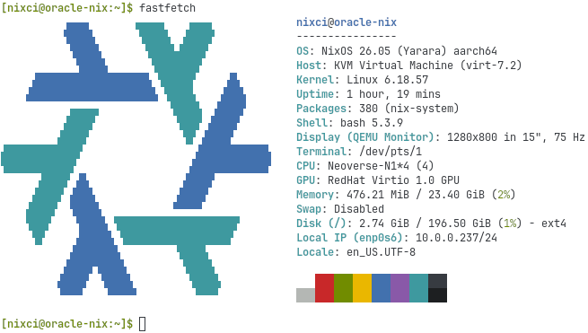

# oracle-nix

NixOS module for Oracle Cloud Infrastructure (Ampere A1).



## Quick start

### 1. Create your own repo from the example

```bash
git clone https://github.com/encore-sr/oracle-nix my-oracle-nix
cd my-oracle-nix
# Edit example/configuration.nix with your settings
```

### 2. Build the qcow2 locally

This will take a maximum of ~5 minutes.

```bash
./scripts/build-image.sh
```

### 3. Import into OCI (one-time)

This will take a maximum of ~15 minutes.

```bash
nix run github:encore-sr/oracle-nix#import-tools -- scripts/import-image.py result/nixos-image-oci-*.qcow2
```

### 4. The image will now be available

You can find it under "My Images - Custom" via "Custom images", and can use it to create an instance as you normally would.

### 5. Copy over flake.nix

Copy over [examples/flake.nix](examples/flake.nix) to `/etc/nixos` on the Instance (the `configuration.nix` will already be there).

### 6. SSH in and update as normal

Now you can do a normal rebuild in the `/etc/nixos` directory and everything should work as normal!
